# mb-8433UUD — open replacement BIOS for the Biostar MB-8433UUD-A

Goal: the compatibility of the board's Award BIOS (v4.50PG UUD960306I on the chip):
DOS and Linux 6.18 run as under the original, the RTL8139C socket ROM boots over the network, an
Award-like setup utility (main menu, pages, values) configures the board, the POST shows CPU, memory
test and drives. Developed and tested in a patched 86Box before touching the real board.

Status 2026-10-16: all emulator tests pass (`test/run_all.sh`); runs on the real board (DOS, Linux from IDE and
USB, network boot); the BOARD TEST and HDD SURFACE SCAN pages are tested in 86Box only so far. Published: `out/release/newbios-mb-8433UUD-A.zip` (`boards/mb8433uud/release.sh`: BIOS.bin, POSTCODES.txt and `dist/README.txt`). POST codes
for a POST card: [POSTCODES.md](POSTCODES.md); everything that is not C: [ASM.md](ASM.md).

## Screenshots (86Box)

| | |
|---|---|
| 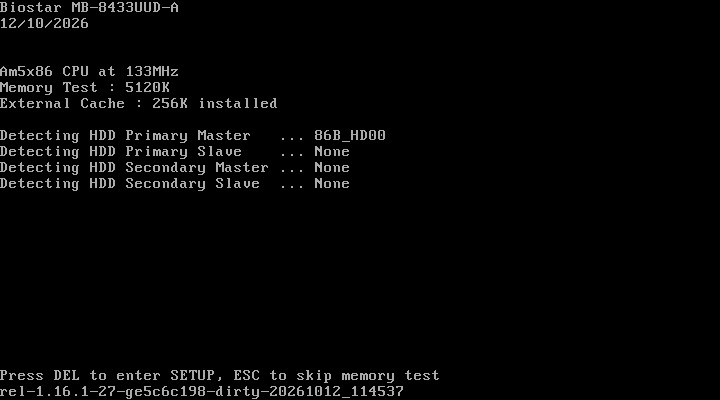 | 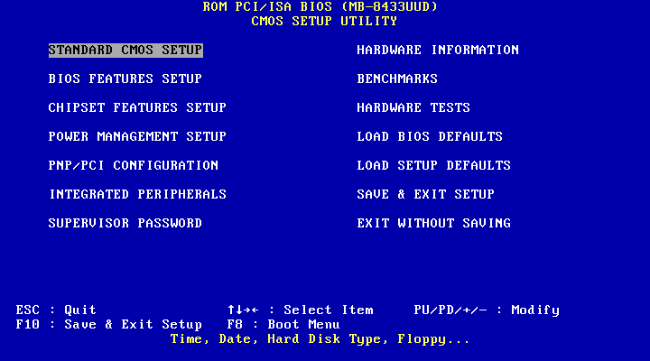 |
| 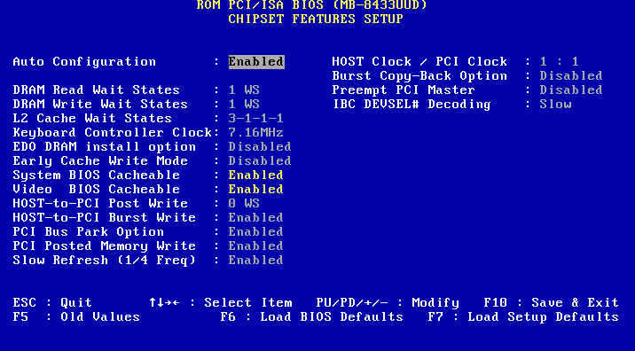 | 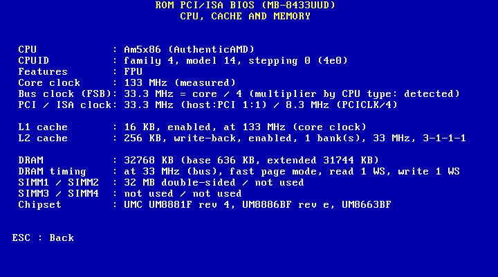 |
| 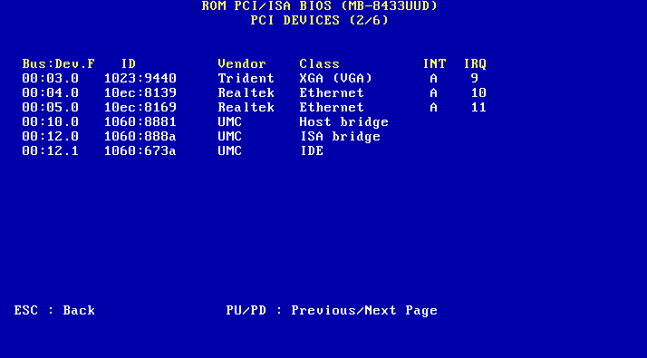 | 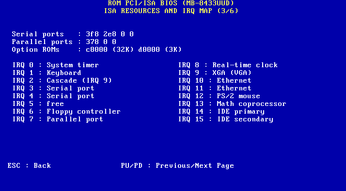 |
| 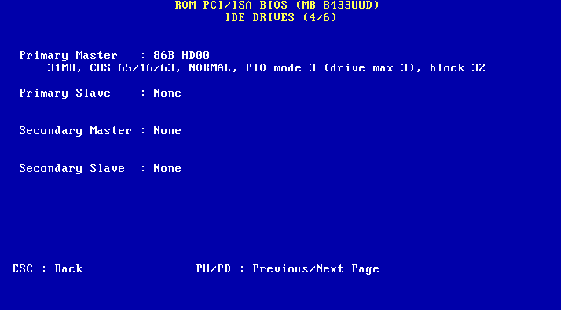 | 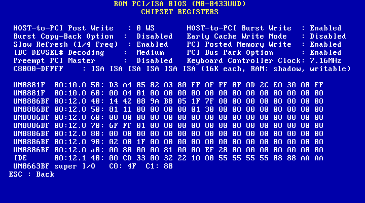 |
| 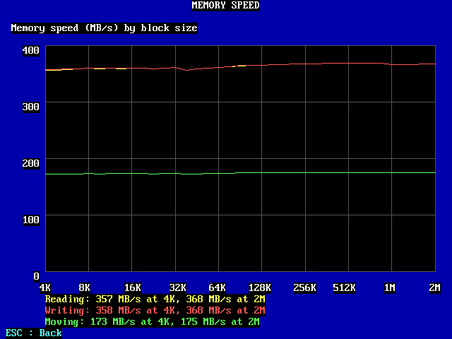 | 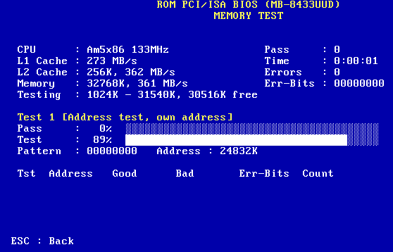 |
| 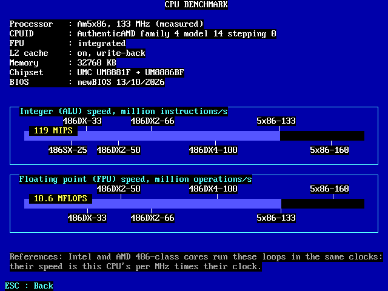 | 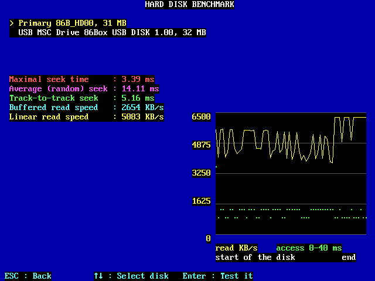 |
| 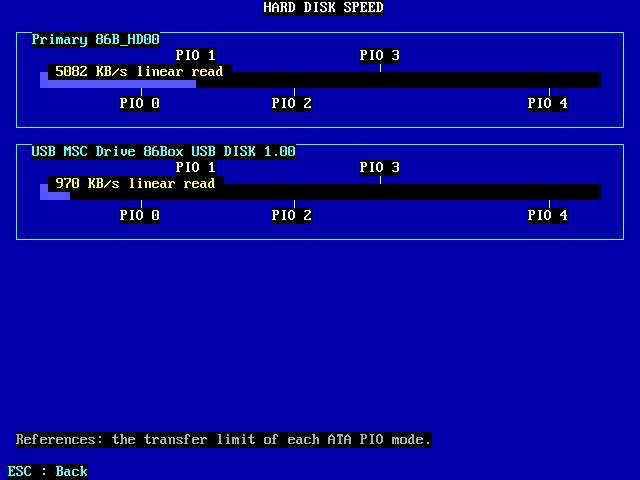 | 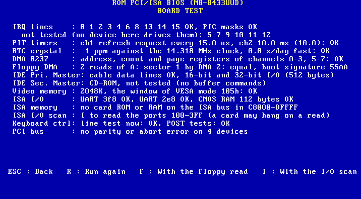 |
| 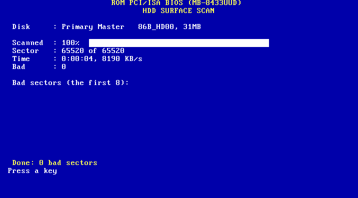 | 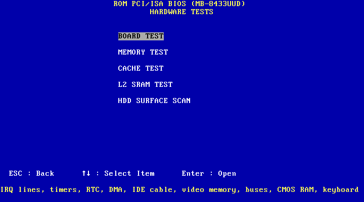 |

## Does it fit in the 128 KiB flash? Yes

`out/newbios.rom` (CBFS, sizes in bytes):

| Part | Size | Content |
|---|---|---|
| bootblock | 3,264 | reset vector, cache-as-RAM, CBFS lookup |
| romstage | 7,572 | UMC DRAM sizing, L2 cache, PCI quiesce, chipset setup values (XIP) |
| postcar | 8,416 | leaves cache-as-RAM, loads ramstage; in the flash above the ESCD |
| ramstage | 25,767 | PCI enumeration/resources, IRQ routing, Auto chipset timings, coreboot tables (LZMA) |
| payload | 75,486 | SeaBIOS (USB 1/2 included) + setup utility + POST screen + memory test + benchmarks + L2 diagnostics + board test + surface scan + ISA PnP and PnP BIOS (LZMA) |
| escd | 4,096 | PnP ESCD in the flash parameter block at 0x1C000 |
| other | 575 | CBFS header, file headers and alignment |
| **free** | **5,896** | 5,476 below the ESCD (where the payload grows), 420 above it |

One compression method, LZMA: SeaBIOS 38,992 vs 41,486 bytes with zstd, ramstage 36,109 vs 38,587, and the
zstd decoder alone is 31,839 bytes against 7,706 for LZMA. Bootblock and romstage run in place from the
flash and postcar stays uncompressed: the LZMA decoder would cost more in romstage than it saves. The
decoder in postcar and ramstage is compiled for size (`-Os` instead of coreboot's `-Ofast`: 5 KB less,
no measurable boot time difference in 86Box). LZMA with 3 literal context bits (`lc=3`, cbfstool's was 1): 575 bytes
less on the payload and ramstage; it is the most coreboot's decoder takes (its 15,980-byte probability table), its
decoding speed on the board is not measured. coreboot is compiled with a 4-byte stack alignment
(`-mpreferred-stack-boundary=2`; the 16-byte default only costs code on a 486: 384 bytes less on postcar, about 1 KB
on the other stages), which lets postcar fit in the 8,768 bytes between the ESCD and the bootblock and leaves the
space below the ESCD to the payload; its PCI Express, CardBus and PCI-X support is left out (no such bridge on a 486
PCI bus: 1.2 KB). The flash ROM has no coreboot text console (its console code alone is 7 KB, 13 KB with its
messages; the serial port stays silent like under Award); it sends POST codes instead. `DEBUG=1` builds
`out/newbios-debug.rom` with SeaBIOS's level 1 log on COM1 at its key places (versions, memory relocation, the UM8881F
DRAM/L2/shadow values coreboot set, CMOS state, PCI devices, option ROMs, drives, keyboard, USB, boot, warnings by
caller address and source line: `out-debug/rom.o`'s symbols name the function); coreboot's log does not fit, its
POST codes time its steps.

## Why coreboot + SeaBIOS (and not Open Firmware)

- DOS needs the real-mode BIOS services (INT 10h/13h/15h/16h/1Ah, PnP/PCI option ROMs, BBS boot).
  SeaBIOS implements them; Open Firmware (openfirmware.info) is an IEEE 1275 Forth firmware whose x86
  build only "emulates enough legacy BIOS real mode INTs to boot Windows XP" on the OLPC; OpenBIOS (same
  site) must not be used as a real boot ROM. Neither knows the UMC chipset.
- coreboot_486 (pc2005cz) already initializes the UM8881F/UM8886BF (DRAM, L2, shadow, IDE) in auditable
  C on this exact board; seabios_486 is SeaBIOS 1.16.1 with that author's 486 patches.

## POST screen

Text mode 80x25 like the original (one resolution in the whole BIOS), no logo. Board name and release
(build) date, SeaBIOS version and build time at the bottom left, `<CPU> CPU at
<MHz>MHz` (CPUID name, clock measured), `External Cache : nnnK installed`, `Memory Test : nnnnnK OK` (every
free 4 KiB block written/flushed/verified with two patterns, non-destructively; Quick POST tests one dword
per KiB; ESC skips, DEL requests setup), IDE drives detected in parallel (one thread per channel), each
shown as it goes (`Detecting HDD Primary Master   ... <model>` or `None`), then an
Award-style system configuration box (CPU, FPU, clock, memory, L2 size, floppies, serial/parallel ports,
each IDE drive with size, PIO mode and model), the original BIOS's POST errors (`Floppy disk(s) fail
(80)`, `Hard disk(s) fail (80)`, `Keyboard error or no keyboard present`, `CMOS checksum error - Defaults
loaded`, `CMOS battery failed`, `Memory test fail at <4 KiB block>`) and, as Halt On decides,
`Press F1 to continue, DEL to enter SETUP`; then `Press DEL to enter SETUP, ESC for boot menu`. ISA PnP
cards are listed (`Initializing Plug and Play Cards...`, `Card-01: ...`) before the box.

## Setup utility (DEL)

Award layout: main menu in two columns, pages with values, Esc/arrows/PgUp/PgDn/+/-, F5 old values,
F7 defaults, F10 save & reboot (Y/N), Esc in the main menu quits without saving.

| Page | Options | Applied by |
|---|---|---|
| STANDARD CMOS SETUP | date, time; per IDE drive TYPE (Auto, None, the AT types 1-46, User with typed cylinders/heads/sectors: a fixed type is the INT 13h geometry) and MODE (Auto/Normal/LBA/Large) with size and CHS; floppy A/B; Halt On (All Errors, No Errors, All But Keyboard/Diskette/Disk-Key); memory sizes | SeaBIOS (RTC, ATA, INT 13h translation, FDC) |
| BIOS FEATURES SETUP | CPU internal cache, external cache, 1st-4th boot device (Floppy, Hard Disk, CD-ROM, Network, USB; default Hard Disk, USB, Network, Floppy), setup prompt delay, swap floppy, NumLock, typematic rate/delay, security option, Quick POST, IDE HDD block mode (READ/WRITE MULTIPLE), C8000-DFFFF shadow (6 blocks) | SeaBIOS (CR0, keyboard, boot order, ISA ROM copy); coreboot (L2 enable) |
| CHIPSET FEATURES SETUP | Auto configuration (the original BIOS's table: DRAM/L2 wait states, ISA and PCI clocks per bus clock 25/33/40/50 MHz, from the measured core clock and the multiplier of the CPU; System/Video BIOS cacheable stay settable); DRAM read/write wait states, L2 wait states, KBC clock, EDO, early cache write, system/video BIOS cacheable, host-to-PCI post write and burst, PCI bus park, PCI posted write, slow refresh, host/PCI clock, burst copy-back, preempt PCI master, IBC DEVSEL# | coreboot romstage |
| POWER MANAGEMENT SETUP | APM BIOS, HDD standby timer | SeaBIOS |
| PNP/PCI CONFIGURATION | PCI INTA#-INTD# IRQ (Auto or 3-15), IDE PIO mode per drive (Auto, 0-4), IDE 32-bit transfer, PnP BIOS Auto-Config (ISA PnP cards get free I/O, IRQ and DMA at POST; off: left inactive for the OS) | coreboot (PIRQ), SeaBIOS (UM8886BF timings, SET FEATURES) |
| INTEGRATED PERIPHERALS | onboard IDE primary/secondary, FDC, serial 1/2 (COM1-4 or off), parallel (378/278 or off) and mode (SPP/EPP/ECP) | SeaBIOS (UM8886BF, UM8663BF) |
| HARDWARE INFORMATION | CPU (CPUID vendor/family/model/stepping/features, Socket 3 names incl. Cyrix DIR0), clock, L1/L2, DRAM, each SIMM socket (size and sides as the chipset uses it: a SIMM present but "not used" was left out), chipset revisions; PCI devices with vendor, class, INT pin and IRQ; ports, ISA option ROMs and IRQ 0-15 map; IDE drives (model, size, CHS, translation, PIO used/maximum); the CHIPSET FEATURES options as the chip has them (with Auto Configuration, or after unfinished POSTs, those are coreboot's values, not the page's), which 16K blocks of C8000-DFFFF are shadow RAM or ISA, and the register dump (UM8881F, UM8886BF, IDE, UM8663BF) | read-only |
| BENCHMARKS | in VGA mode 12h (SpeedSys style): memory read, write and move speed over 37 block sizes 4K-2M (L1, L2 and DRAM show as steps on the real board, flat in 86Box, which has no cache timing); CPU integer (MIPS) and FPU (MFLOPS) bars against Intel/AMD 486-class CPUs (same clocks per instruction: their speed is this CPU's per MHz times their clock), with the system data; hard disk benchmark of any IDE or USB disk (maximal, random and track-to-track seek, buffered read, linear read and access time across the disk; ESC stops it, a read over 2 s ends it); hard disk speed bars against the ATA PIO mode limits | read-only |
| HARDWARE TESTS: MEMORY TEST | endless passes (pass counter, pass and test progress bars) of the default pass of memtest86+ 4.20 (tests 0-8: address walking ones and own address, moving inversions ones & zeros, 8-bit, random and 32-bit patterns, block move, random number sequence, modulo 20), reimplemented on the RAM above 1 MiB that POST does not use; CPU, L2, memory size and the POST read speeds in the header; pass count, time, errors with address, expected/read value, bits and count; F: bit fade passes instead (all zeros, then all ones, each left alone 5 minutes, only refreshed: weak cells, too slow a refresh); ESC back | setup |
| HARDWARE TESTS: BOARD TEST | each IRQ line raised by its device on the board, seen in the PIC's request register with the IRQs masked (0 timer ticks; 1 keyboard controller; 3/4 UART transmitter interrupt; 6 floppy controller reset; 8 RTC periodic interrupt, and the cascade to IRQ 2; 13 FERR# of an FPU divide by zero; 14/15 CHECK POWER MODE on each IDE channel) and the PIC masks; PIT channel 1 (refresh requests, port 61h bit 4) and 2 (10 ms one-shot); the RTC crystal against the 14.318 MHz clock (ppm, s/day); 8237 address, count and page registers; drive A read twice by DMA (F); each IDE drive's cable by WRITE/READ BUFFER with 16- and 32-bit I/O (wrong DD lines named); PCI error bits (parity, SERR#, aborts) set during the test; UART scratch registers, CMOS RAM 0E-7F (not the shutdown code 0F and century 32); ISA cards in C8000-DFFFF: ROM checksums, RAM written and read; with I, the ISA I/O ports 100h-3FFh that answer (the board's own not read; a card may hang the bus on a read); the whole video memory, as large as the VESA BIOS reports, through a linear frame buffer that is a PCI card's BAR or a 64K window (the largest 256-color mode's: how far the window reaches is told), else the 4 VGA planes (256K): tagged for aliases, then written and read; keyboard controller line test. POST codes C8h-CFh: the step running | setup |
| HARDWARE TESTS: HDD SURFACE SCAN | READ VERIFY of every sector of an IDE hard disk, 256 at a time (nothing transferred; CHS, LBA28 or LBA48 addressing): progress, sector, time, KB/s, the bad sectors (the first 8 listed with the error: uncorrectable, not found, ...), the scan goes on after each; ESC stops it. POST code BEh | setup |
| LOAD BIOS DEFAULTS, LOAD SETUP DEFAULTS (also F6/F7 on the pages) | the original BIOS's fail-safe and Setup values, except Standard CMOS | |
| SUPERVISOR PASSWORD, SAVE & EXIT, EXIT WITHOUT SAVING | as in Award (its IDE HDD AUTO DETECTION: the IDE DRIVES page of HARDWARE INFORMATION) | |

The chipset and super I/O register fields are the ones the original BIOS writes for the same values:
`test/oracle/` changes each item of the original setup in 86Box, saves, reboots and dumps the PCI config
space and the super I/O registers (`award_map.txt`). Chipset Auto configuration (default) keeps the
coreboot_486 author's values; manual values start from the Award manual defaults. If two POSTs in a row
do not complete, coreboot ignores the manual chipset values until a POST completes (recovery from bad
timings without clearing the CMOS).

IDE: PIO mode Auto takes the best mode IDENTIFY reports (words 51/53/64), so old PIO 0-2 drives get slow
timings; the drive gets SET FEATURES and the UM8886BF timing registers get the coreboot_486 values for that
mode (the original BIOS leaves them untouched in 86Box). CHS-only drives (no LBA), LBA28 and LBA48 drives
(> 128 GiB, e.g. a 1 TB SSD on an IDE adapter; LBA48 and its block mode added to the 86Box fork) work.

CMOS: AT standard bytes 10h-2Dh (floppy types, equipment, memory sizes, checksum) plus the mb-8433UUD block
from 40h (one nibble per setting, password hash at 78h, signature 7Bh, checksum 7Ch, unfinished-POST
counter 7Eh), defined in `seabios/src/newbios_cmos.h` and shared by SeaBIOS and coreboot. A cleared or Award CMOS loads
defaults.

Not implemented from the Award pages (no effect possible or not needed): virus warning, boot up floppy
seek, gate A20 option, memory parity check, L1 cache update scheme (the original BIOS changes no register
for it), video BIOS shadow (the PCI VGA ROM is always shadowed), video type, power management
timers and wake events (need SMM), slot INT# mapping, PCI IRQ edge/level, assign IRQ for VGA, PCI IDE IRQ
mapping. PnP BIOS runtime functions 00h-0Bh and 40h-43h with the ESCD in the flash parameter block at
0x1C000, like the original BIOS (written only when it changes; Intel BX and Winbond W29C010 flash).

## Compatibility with the original BIOS

| Feature | Award | mb-8433UUD | Test |
|---|---|---|---|
| CPU 486/Am5x86 | yes | yes | all |
| DRAM sizing (4 SIMM banks, 4-128 MB SIMMs), L2 128K-1M, 1/2 banks | yes | coreboot_486 | `ram` (same results as the original BIOS on the fork's model) |
| DOS: INT 10/13/15/16/1A, XMS | yes | SeaBIOS | `dos` |
| IDE primary + secondary, PIO 0-4 per drive, CHS-only and LBA drives | yes | yes | `dos`, `setup`, `chipset`, `bigdisk` |
| Floppy A/B, swap | yes | yes | `setup` (detection) |
| PCI option ROMs, VGA (incl. class 0301) | yes | yes | all |
| ISA option ROMs C8000-DFFFF, RAM in their window | yes | yes, run in place | `devfuzz` (ISA ROMs) |
| ISA shared memory C8000-DFFFF | yes | yes | `dos` (WD8013) |
| NIC boot ROM, PnP/BEV | yes | yes (the card's socket ROM runs) | `pxe` |
| Network boot | NIC boot ROM | NIC boot ROM: Etherboot 5.4.4 in the RTL8139C's socket (the board's 1 Mbit BIOS socket keeps A17 of a 2 Mbit flash high: no room for a boot ROM in the flash) | `pxe`, `warmboot` |
| Drive A default 1.44M, 3.5 in. (Setup defaults) | yes | yes | `setup`, `errors` |
| Linux boot: memory map, APM, PCI IRQ | yes | yes (E820, APM 1.2) | `pxe` (Linux 6.18.55) |
| Chipset/super I/O setup values | yes | same register fields | `chipset` |
| Password (setup / system) | yes | yes | `password` |
| Built-in NCR 53C810 SCSI BIOS | yes | no (operator has no SCSI) | — |
| USB keyboard and boot (PCI card: UHCI, OHCI, EHCI; hub, mass storage) | no | yes (SeaBIOS) | fork: VT6212 card (2 UHCI + EHCI), keyboard, disk |
| POST errors, Halt On, F1 prompt; fail-safe defaults | yes | yes | `errors` |
| Hard disk types 1-46 and User | yes | yes | `hddtype` |
| IDE HDD block mode | yes | yes (also LBA48) | `setup`, `dos`, `bigdisk` |
| Auto chipset timings per bus clock | yes | same table; the core clock is measured with a 16-byte aligned loop (unaligned: 107-121 MHz on a 133), an Am5x86 is 4x only when that alone gives a standard bus clock (the original assumes 4x: 3 x 40 MHz got the 33 MHz timings) | `busclock` (6 CPUs) |
| ISA PnP cards configured at POST, PnP BIOS, ESCD | yes | yes | `isapnp`, `pnpbios` |
| POST codes on port 80h | yes (Award codes) | own codes, [POSTCODES.md](POSTCODES.md) | `post` |
| Board test: IRQ lines, timers, RTC crystal, DMA, IDE cable, video memory, PCI/ISA buses, CMOS RAM, keyboard controller; IDE surface scan | no | yes (setup) | `boardtest`, `vgamem` |
| CGA, MDA, Hercules and other cards without a video BIOS; ET2000, OTI-037C | yes | no (SeaBIOS has no CGA/MDA INT 10h; those two video BIOSes leave the screen blank under it) | `vgamem` (skipped) |

Conventional memory is 636 KiB instead of 639/640 KiB, chosen by the operator: the UMC shadow
write-protect is global, so SeaBIOS keeps its runtime data below 640 KiB to let C0000-FFFFF be
write-protected after POST like under Award.

## Try it in 86Box

`boards/mb8433uud/run_86box.sh [rom]` rebuilds mb-8433UUD if a source changed (without `rom`) and opens the Qt 86Box fork on a persistent VM in
`boards/mb8433uud/vm/` (CMOS, disk and settings kept between runs, flash reloaded from the ROM, RTC not synced to the host).
Hardware: 84xxuuda, Am5x86-133, one 32 MB SIMM and 256 KB L2
(`[UMC HB4(8881F)]` in `vm/86box.cfg`), TGUI9440, FreeDOS disk
on IDE, the operator's RTL8139C (no C+) with Etherboot in its socket ROM if `test/roms/etherboot-5.4.4-rtl8139.rom`
is there (SLiRP DHCP/TFTP): set "1st Boot Device = Network" in setup, ESC at the prompt picks the card. POST card on (codes in the status bar). Drive A 3.5" 1.44M, no drive B;
floppy and hard disk sounds (samples of the 86Box ROM set). The benchmarks are in the
BENCHMARKS menu. `BIOSORIGINAL.bin` (a dump of your board's chip) as argument boots
the original BIOS.

## Build

- `boards/mb8433uud/release.sh` → `out/release/`: the ROMs, only when every test passed; flash only from there.
- `./build.sh` (recipe `boards/mb8433uud/firmware.sh`) → `out/newbios.rom` (1 Mbit flash, and 86Box) and `out/newbios-2mbit.rom` (2 Mbit flash, e.g. a W49F002A: the board's 1 Mbit socket keeps its A17 high, only the upper 128 KiB is reached; the BIOS is in both halves). The 86Box fork emulates the board's Intel 28F001BX-T flash (`BOX86_FLASH=w29c010` for the old Winbond), with WE# gated by UM8886 IBC47 bit 6 and `BOX86_FLASH_VPP=5` for JP13 at 5 V. `HALT_ON=1` builds `out/newbios-halt1.rom`, whose Halt On default is No Errors: POST errors (e.g. a dead CMOS battery, no keyboard) print a WARNING and the boot continues. The SeaBIOS payload is x86 BCJ filtered before LZMA (`tools/bcj_x86.py`, undone by coreboot's loader). `DEBUG=1` adds
  `out/newbios-debug.rom` (SeaBIOS level 1 log on COM1; no coreboot log: it does not fit).
- Network boot tests: `tools/build_ipxe.sh` builds the PXE program Etherboot loads, iPXE's realtek driver with the
  10ec:8039 clone added (`ipxe` submodule, config `configs/ipxe`), as `build/ipxe-chain.pxe`; it runs the
  test's `boot.ipxe` from the TFTP server.
- The 86Box fork also models the UM8881 L2 in normal mode until it is coherent with DRAM (random power-on
  tags, data and dirty bits, no valid bit, write-through/write-back; hypothesis: with a size programmed it
  fills lines even with 50h bit 7 clear), the RTL8139 PCI device ID (`device_id`) and a plain RTL8139C (`cplus = 0`),
  an Am5x86 at 3 x 40 MHz, LAN background broadcasts (`BOX86_NET_NOISE_MS`), key combinations in the test control (`combo`), the board's VIA VT6212 USB card (2 UHCI + EHCI, port handoff to the companions) with a low-speed keyboard and a high-speed disk (`BOX86_USB_KBD`, `BOX86_USB_DISK`, `usbkey`), port 92h without reset as on the real board, the Intel flash above, a W49F002A 2 Mbit flash (`BOX86_FLASH=w49f002a`, 256 KiB image) with A17 kept high as in the board's 1 Mbit
  socket (its lower half unreachable), and the power-on time of the 8042 and keyboard.
- Sources: the forks are submodules, each a git repository whose branch `retro` holds our commits on the pinned
  upstream: `coreboot` and `seabios` on the 486 trees of their author,
  [pc2005cz/coreboot_486](https://github.com/pc2005cz/coreboot_486) and
  [pc2005cz/seabios_486](https://github.com/pc2005cz/seabios_486); `86box` on 86Box v6.0; `ipxe`. Builds go to
  `build/`, the submodules stay clean. `fetch_sources.sh` (run by the builds) checks them out and downloads the
  tarballs of the tests into `sources/`: FreeDOS 1.3, Linux 6.18. `tools/build_toolchain.sh` builds coreboot's
  i386 cross compiler once (it downloads GCC and binutils). SeaBIOS options in `seabios.config`, coreboot options
  in `boards/mb8433uud/coreboot.config` + `build.sh`, CMOS layout `seabios/src/newbios_cmos.h` (the copy in
  `coreboot/src/mainboard/biostar/mb8433/` must stay equal: `build.sh` refuses otherwise).
  `test/images/usb.img.tar.xz` is the board's USB stick (LILO, Linux, FreeDOS in place of MS-DOS; sparse, 62 GB
  unpacked to ~150 MB) made by `test/images/make_usb_img.sh` from the HDD project; the tests unpack it when missing.
- Where the bytes go: `tools/filelight.sh [rom]` (default `newbios`) opens Filelight on a tree made in RAM: CBFS
  entry, source file, function or variable; each file is 1024 times its bytes in the ROM (Filelight counts 4 KiB disk
  blocks): read its MiB as KiB of ROM. Compressed entries are shared in proportion; `(strings)`, `(cbfs header)`,
  `(free)` as named (`tools/rom_size_tree.py`).
- Host: a Linux with gcc, make, git, curl, python3, unzip, nasm (tests), cmake and Qt6 (86Box GUI).

## Tests (86Box fork)

`test/run_all.sh [test...]` builds what is missing and runs the tests in parallel, one 86Box each,
headless, driven through the fork's test FIFO (keys in; text screen, PCI config space and I/O ports
out) and COM1:

| Test | Checks |
|---|---|
| `setup` | defaults on cleared CMOS (drive A 1.44M), all menus, date/floppy/boot order edited and kept after F10, hardware information pages, secondary IDE disk |
| `dos` | POST screen (board, release date, "Detecting HDD" lines, version); FreeDOS 1.3 from IDE (CHS-only drive), HimemX, 636 KiB + 31 MiB XMS, WD8013 shared RAM at D0000; L1 cache on, Auto chipset timings as the original BIOS, no PCI interrupt on IRQ 14/15 |
| `pxe` | the board's 2 Mbit flash (A17 high), DOS disk, the operator's plain RTL8139C with Etherboot in its socket ROM: default order boots DOS; "Network" first → Etherboot → DHCP → iPXE by TFTP → Linux 6.18.55 (e820, APM, 8139too, sda) |
| `floppy` | boot from drive A: boot sector reads sector 2 with INT 13h |
| `chipset` | manual chipset values, external cache off, PCI INTA# IRQ, PIO mode 2, serial/parallel settings program the original BIOS's register fields; fallback after unfinished POSTs (warning on screen); System/Video BIOS cacheable as the original; internal cache off still off in DOS |
| `password` | password asked before boot (System) and for setup, wrong one refused |
| `bigdisk` | 1 TB LBA48 disk: size, LBA translation, INT 13h extended read beyond 128 GiB, then 64 sectors written and read back there in block mode (READ/WRITE MULTIPLE EXT), checked in the image |
| `post` | POST codes of a boot, setup and its memory test equal the order in POSTCODES.md. Every 86Box test also runs the double POST probe (`test/lib.sh` `post_once`): no POST step twice between CPU resets, no unrequested reset mid-POST, no USB bus mastering left on at a reboot |
| `errors` | cleared CMOS halts on "CMOS checksum error" until F1/DEL; drive A set up but absent: "Floppy disk(s) fail (80)", no halt with Halt On "All, But Diskette"; LOAD BIOS DEFAULTS keeps Standard CMOS |
| `hddtype` | User type typed in setup is the INT 13h geometry (FreeDOS boots, translation TYPE); type 2 without a drive: "Hard disk(s) fail (80)" |
| `busclock` | Am486DX2-50/80, Am486DX4-120, i486DX-50, Am5x86-133: clock shown and Auto chipset fields equal to the original BIOS's (`test/oracle/busclock.sh`); Am5x86 at 3 x 40 MHz: the 40 MHz timings |
| `isapnp` | RTL8019AS PnP card isolated and given 220h/IRQ 5 (answers there); inactive with PnP BIOS Auto-Config off |
| `pnpbios` | PnP BIOS from DOS (real and 16-bit protected mode): system nodes, ISA configuration, ESCD read, write, reset restores POST's ESCD |
| `memtest` | MEMORY TEST on a 4 MB SIMM: a full pass without errors; with a faulty bit in the fork, POST reports the block and the test the address, values and bit |
| `ram` | 9 SIMM/L2 configurations (one bank to four, double sided, MA11 12-row DRAMs, region swap, bank 1 alone, no L2 to 1 MB in 1 or 2 banks): memory and cache on the POST screen, memory test, chipset fields |
| `dramfuzz` | native, no emulator: coreboot's DRAM/L2 sizing (`raminit.c`, `memmap.c`, romstage defaults) and SeaBIOS's `setup_l2_cache` (the L2 is enabled at POST like the original BIOS; coreboot only sizes it), compiled unchanged against a C port of the fork's UM8881 model with a normal-mode L2: all 10^4 SIMM combinations x 100 L2 variants (absent, 64K-1M in 1 or 2 banks, random power-on contents, fake data SRAM and/or tag RAM, setup/CMOS guard): RAM top, every 4 KiB page present and distinct, no false L2 hit, register fields as `ram` and the original BIOS |
| `cmosfuzz` | native: the CMOS values coreboot reads (`newbios.c` chipset options, Auto timings, PCI IRQ presets through the PIRQ routing), compiled unchanged against CMOS/PCI/PIT seams with bounds, division and shift traps: only documented fields and values written, romstage and ramstage agree on manual/Auto, no IRQ outside the routing table's mask |
| `l2guard` | valid CMOS: setup entered and reset three times keeps the L2 on; an L2 init left unfinished (CMOS 3Eh bit 7) leaves it off once, reason on the CPU page |
| `halt1` | the `HALT_ON=1` ROM: POST errors print a WARNING, DOS boots without a key |
| `bootmenu` | F8 in the setup main menu leaves setup into the boot menu |
| `fmtlint` | no SeaBIOS-unsupported printf formats (`%*s`, flags, padded `%s`) in the patched sources |
| `cachetest` | the verdict of `tools/cachetest.c` on synthetic speed curves |
| `kbdpower` | cold boot with a slow 8042 and keyboard (86Box `BOX86_KBC_POWERON_MS`/`BOX86_KBD_POWERON_MS`, up to 1 s and 2.5 s): keyboard found and working; a 15 s silent keyboard gives the keyboard error without halting the boot (no keyboard to press F1), then types once awake |
| `flashtime` | 86Box counts of instructions fetched and bytes read from the flash (8-bit ISA on the board, ~1 us a byte): POST under 1 s of flash time, nothing from the flash after it |
| `boardtest` | setup BOARD TEST on the emulated board (IDE disk and CD-ROM, floppy, WD8013 RAM, an ISA ROM, TGUI9440 2 MB): every test OK, again with the floppy DMA read, the I/O scan finds the WD8013's ports, then DOS boots and the CMOS is intact; with 86Box faults (`BOX86_IRQ_FAULT` on IRQ 4 and 8, `BOX86_IDE_DATA_FAULT` on DD3, `BOX86_REFRESH_DEAD`, `BOX86_VRAM_FAULT`, a ROM with a bad checksum) each one is named; MEMORY TEST's bit fade finds the fork's stuck bit with the all-ones pattern only (the RTC advanced past its waits); HDD SURFACE SCAN lists the fork's bad sectors (`BOX86_IDE_BAD_LBA`, the last one included), stops on ESC, and DOS still boots |
| `vgamem` | BOARD TEST's video memory test on every video card 86Box offers for this board (`BOX86_LIST_VIDEO`), default memory sizes (`vgamem.sh all`: every size, 207 runs): no error, no alias, the size the card's VESA BIOS reports (a linear frame buffer on 32, a window on 85, the VGA planes on 66, 20 not a VGA, in the full run) |
| `cachepage` | setup CACHE TEST: the 16 L2 settings run and work on the emulated L2, the POST's write-back L2 is on again afterwards |
| `l2sram` | setup L2 SRAM TEST on 64K-1M, 1 or 2 bank L2s (all found, all OK), then 86Box faults injected (`BOX86_L2_FAULT=bank:lane:mask`, `BOX86_L2_TAG_FAULT=mask`): a chip with a stuck bit, a dead chip, a tag bit, the dirty bit, two faults at once: each named; a POST that stopped with the L2 on leaves it off at the next |
| `otherflash` | a JEDEC flash chip mb-8433UUD does not know (86Box `BOX86_FLASH=sst39sf010`, as a W49F002A or SST39SF010A): POST, save and reboot, reset; the flash is not written |
| `warmboot` | Ctrl+Alt+Del (keyboard controller reset: the board's port 92h does not reset; CPU only, not the chipset) on the operator's setup (2 Mbit flash, RTL8139C with Etherboot, Am5x86 3x40): from DOS twice, from the setup, then three times with the card left receiving by iPXE (loaded by Etherboot) while LAN broadcasts arrive every ms (`BOX86_NET_NOISE_MS`): the POST always finishes |
| `flashlinux` | BIOS update from Linux on the emulated board (W49F002A, A17 high, its JEDEC commands and sector map, programming only clears bits), booted by Etherboot + iPXE: flashrom (UMC patch) refuses a plain 2 Mbit write (the real board's lost BIOS), `bios-update` refuses a wrong size, reads the chip back as the image, rewrites the 96 KiB main block and a boot block byte; after a reset the rewritten BIOS runs, the upper half holds it, the lower half is untouched |
| `usbkbd` | USB keyboard only (86Box VT6212 like the operator's card, handed from EHCI to its UHCI companion, low-speed HID keyboard; the PS/2 keyboard never answers): no keyboard error, F1/DEL/setup navigation and Ctrl+Alt+Del on it work, the USB page lists it; with an AT keyboard too (also one waking after the POST's 3 s), both type |
| `usbboot` | FreeDOS from a USB disk (bulk-only mass storage), then Ctrl+Alt+Del twice while the USB controller still runs: the POST finishes and boots from USB again; with an IDE disk too, the default order boots the IDE disk and "1st Boot Device: USB" the USB one |
| `awarddefaults` | `tools/award_defaults.py` (own -lh5- encoder/decoder) changes the original Award BIOS's setup defaults (External Cache off, boot C,A): the patched 2 Mbit image boots in 86Box with them on a cleared CMOS and the L2 off |
| `usbfault` | USB faults injected by the emulator (`BOX86_USB_FAULT`): keyboard stalling its requests (keyboard error, no hang), disk never sending data, stalling READ, bad CSW signature (POST finishes, boot fails with a message), disk unplugged after its first READ then Ctrl+Alt+Del (POST finishes without it) |
| `usblilo` | LILO's 3 s prompt from a USB disk without an AT keyboard (the board's 8042 then hangs, `BOX86_KBD_ABSENT`): the countdown runs out with a USB keyboard and with none (HALT_ON=1 ROM) |
| `nokbd` | the operator's setup: no AT keyboard (hung 8042), USB keyboard and stick on the VT6212: F1, every setup page, F10 save and warm reboot (the USB keyboard still found: EHCI hands it over before its companions scan), boot menu, LILO "dos", MS-DOS "ver", Ctrl+Alt+Del resets within 3 s, then Linux finds the disk on EHCI and the keyboard on UHCI with no stray interrupt; with no keyboard at all the POST errors do not halt the boot |
| `bench` | benchmark pages (SpeedSys style: black, 8x8 font) on 86Box screenshots, by pixel colors and by their text (`test/bench/gridocr.py` matches each 8x8 cell against the video BIOS font exactly; no AI in the tests): memory chart curves (read, write, move), CPU ALU bar, linear read curve of the IDE disk, a speed bar per disk (IDE and USB); back to text mode after each |
| `deadcmos` | dead CMOS battery: random CMOS images (RTC registers, shutdown code 0Fh, mb-8433UUD block, boot-failure counter) at power-on; POST reaches the F1 prompt and DOS boots |
| `devfuzz` | native: SeaBIOS IDE/ATAPI, floppy, PCI option ROMs, ISA ROMs and ISA PnP, USB (UHCI/OHCI/EHCI, hubs, keyboard, storage) and CMOS/setup, compiled unchanged under ASan/UBSan with SeaBIOS's own printf engine (src/output.c), against fault-injecting device models (edge values, garbage, never-ready devices, USB controllers still running after a warm boot: stopped before bus mastering), a ROM in a 2 Mbit flash's unreachable lower half never run: no hang, crash or overflow |

Inputs: `sources/` (`fetch_sources.sh`); the 86Box ROM set ([86Box/roms](https://github.com/86Box/roms) in
`~/.local/share/86Box/roms`: VGA BIOS); the test kernel (`test/linux/build.sh`, whose busybox and glibc
come from the target directory of the coreboot_486 author's
[buildroot_486](https://github.com/pc2005cz/buildroot_486) build in `sources/buildroot_486/output`).
`test/oracle/sweep.sh`, `sweep2.sh` and `diff.py` regenerate `award_map.txt` from `BIOSORIGINAL.bin` (a
dump of the board's original BIOS, not included); `award_findings.md` is what reading that image taught; `test/oracle/ram.sh <config>` prints
what the original BIOS and mb-8433UUD find on one SIMM/L2 configuration, as a `test/ram.sh` line.

86Box fork (`build_86box.sh`, `86box` submodule on 86Box 6.0): test control FIFO
(`$BOX86_TESTCTL`: `key`, `text`, `pci`, `in`, `out`, `cr0`, `shot` (PNG screenshot), `rtcadd` (RTC forward), `reset`, `quit`); POST card
log (`$BOX86_POSTLOG`); RTL8139 boot ROM socket
(`roms/network/rtl8139c/rtl8139c.rom`) and MMIO BAR mapped whatever the order of BAR/command writes; PCI
RTL8169S gigabit NIC `rtl8169` with its own boot ROM socket (`roms/network/rtl8169/rtl8169.rom`), a variant
of the RTL8139C+ code (same descriptor rings; chip XID 008, TxPoll 38h, RxMaxSize, PHYAR to a PHY with the
RTL8211 ID, always linked at 1 Gbps full duplex; no jumbo frames, TBI, high-priority queue, Wake-on-LAN); SLiRP
TFTP (`$BOX86_SLIRP_TFTP`, `$BOX86_SLIRP_BOOTFILE`); 386+ CPU-only reset fetches from the ROM (CS base
FFFF0000); UM8886BF multi-function bit; IDE LBA48 (with READ/WRITE MULTIPLE EXT), READ/WRITE BUFFER, VERIFY beyond the last sector refused; the floppy controller lowers IRQ 6 at SENSE INTERRUPT STATUS, as the 8272; the GD5420's bank register reaches its 1 MB (8 bits); the Bochs SVGA's linear frame buffer placed when memory decode comes on after its BAR was written; faults for the BOARD TEST: IRQ lines that never reach the PIC (`BOX86_IRQ_FAULT=<hex mask>`), IDE data lines read as 0 (`BOX86_IDE_DATA_FAULT=<hex mask>`), no refresh request (`BOX86_REFRESH_DEAD=1`), a video memory bit stuck at 0 (`BOX86_VRAM_FAULT=<offset>:<mask>`), sectors VERIFY cannot read (`BOX86_IDE_BAD_LBA=<lba>,...`); `BOX86_LIST_VIDEO=<file>` lists the machine's video cards and memory sizes. UM8881 DRAM/L2 model (`chipset/umc_hb4.c`, device
options `bank0`-`bank3` SIMM type, `l2_cache` KB, `l2_banks`, `stuck_addr`/`stuck_bit` faulty RAM bit
read as 0; all banks empty keeps the stock flat RAM):
CPU addresses decoded to SIMM cells as registers 52h/53h/61h program them, MA mapping from the UM8881F
documentation, L2 SRAM answering forced hits (5Ah bit 6), and the CPU's internal cache as RAM (lines read
after INVD kept while CR0.CD and NW are set), so the unmodified coreboot raminit runs in 86Box. On 18
configurations the original BIOS gets the same sizes and register fields as mb-8433UUD 13 times; it rejects a
64 KB L2, sees a 64 MB 12/11 double-sided SIMM as 32 MB and does not start with bank 0 empty or with a
12/10 double-sided and an 11/11 single-sided SIMM in one pair. `GUI=1` also builds the Qt GUI used by
`boards/mb8433uud/run_86box.sh`.

## Changes to the upstream trees

SeaBIOS (`seabios` submodule): setup utility, POST screen and memory test (`src/setup.c`); CMOS boot
order, prompt delay, password; floppy types and swap; ATA: CHS-only drives, PIO mode per drive with
UM8886BF timings, drive type None, 32-bit transfer switch, standby timer; translation from setup; APM
switch; XGA/pre-2.0 VGA class accepted as display; AT keyboards that NAK the scan set command; ISA option
ROMs run in place (UMC shadow blocks routed to ISA, writes to the bus while they run) or copied when
shadowed in setup, unused C8000-DFFFF blocks back on the ISA bus; runtime data below 640 KiB with the
shadow write-protected after POST; port 92h reset with a 0→1 edge; POST codes B0h-BDh; the temporary low
memory zone limited to conventional RAM (this port's E0000 EBDA minimum let it reach C8000-DFFFF, which
goes back to the ISA bus after the option ROMs); CR0.CD/NW kept across mode switches and set from setup
after a CPU-only reset (the "CPU Internal Cache" option); USB 1/2; POST errors with Halt On (floppy
recalibrate check, PS/2 keyboard flag); IDE block mode (SET MULTIPLE MODE, READ/WRITE MULTIPLE and their EXT forms); the port's
trace prints moved from debug level 1 to 3; fixed
drive types as INT 13h geometry; ISA PnP configuration at POST; CPU name and clock without CPUID; drive
detection lines at POST; PnP BIOS runtime and ESCD (`pnpbios.c`); L2 enabled at POST like the original BIOS
(`setup_l2_cache`); port I/O ordered with memory (`x86.h`);
version string without host name, release date (`scripts/buildversion.py`).

coreboot (`coreboot` submodule): setup values for chipset, external cache and PCI IRQs
(`mainboard/biostar/mb8433/newbios.c`) with the unfinished-POST fallback; PCI devices turned off before
DRAM sizing (after a warm reset a VGA framebuffer BAR was sized as RAM); both IDE channels; PIRQ router
found at 00:12.0 (the IBC reports 886a or 888a); POST codes on port 80h (`include/cpu/486/newbios_post.h`, also from
the assembly, which sent ASCII characters to COM1); no `printk` in romstage/ramstage without a serial
console (`console/Makefile.inc`, `console/console.h`), `printk` above the build log level compiled out;
the raw COM1 dumps and test prints of the port removed; Auto Configuration = the original BIOS's table per bus clock, set in ramstage from the measured core
clock and the multiplier (CPUID, else the reset signature that `cpu/486/entry16.S` keeps in CMOS 7Fh),
romstage starting with its 33 MHz row (DRAM 1 WS, L2 3-1-1-1, no burst copy-back, no EDO: the previous
values froze benchmarks); `DECOMPRESS_OFAST` settable (`lib/Kconfig`), off; System/Video BIOS cacheable kept (with 58h/59h as
the original); PCI interrupts on IRQ 9-11 (15 is the secondary IDE); postcar read loop from ESI.

## Before flashing the real board

- Chip: Intel P28F001BX-T. Back up the board's original BIOS first and verify the dump (e.g. with a T48:
  `minipro -p "P28F001BX-T@DIP32" -r BIOSORIGINAL.bin`, read twice and compare). Program and restore
  (minipro erases and verifies by default): `minipro -p "P28F001BX-T@DIP32" -w out/newbios.rom` /
  `... -w BIOSORIGINAL.bin`.
- Only testable on the board: DRAM/L2 sizing on real SIMMs (the emulated model agrees with the original
  BIOS but is built from the chipset documentation), UMC shadow bits used for ISA ROMs, port 92h reset,
  IDE timings, PCI IRQ routing, manual chipset values (keep Auto configuration first).
- `out/newbios.rom` sends POST codes ([POSTCODES.md](POSTCODES.md)) to a POST card and as `XX` lines on COM1;
  `DEBUG=1` builds `out/newbios-debug.rom`, which also logs SeaBIOS's key places on COM1 (115200 8N1), with the
  chipset values coreboot set (coreboot's own log does not fit in the flash).

## License

The scripts, tests and documents of this repository: GPL-3.0 (`LICENSE`). The forks in the submodules
modify, and keep the licenses of, their projects: coreboot (GPL-2.0), SeaBIOS (LGPL-3.0) and
86Box (GPL-2.0-or-later). No BIOS image, firmware blob or ROM is distributed here.

## Testing on the board without reflashing

**CACHE TEST** in the setup menu HARDWARE TESTS: the L2 init with each write policy, timing (50h bits 5-4) and tag width, and the read speed inside the L2 against DRAM for those that work. The line of a setting is on screen before it runs: if it hangs, reset (the next POST leaves the L2 off once).

**L2 SRAM TEST** in the setup menu HARDWARE TESTS: the L2 chips tested in place at full speed, on any L2 the UM8881 takes
(64K-1M, 1 or 2 banks, found by aliasing byte lane by byte lane). Data chips through the chipset's forced hit mode
(5Ah bit 6): a table bank x data bits (D0-D7 ... D24-D31) says which chip is OK, BAD (the failing bits) or DEAD
(missing); to locate a chip on the board, remove one and test again. Tag RAM (the 9th chip): lines filled with
tags that vary line by line must hit again (a stuck tag bit is named); the dirty bit (7+1 tags): a line written in
write-back and evicted must reach DRAM. A bad L2 crashes the POST once it is on: the next POST leaves it off and
says so ("the previous POST stopped with it on"), so the setup and this test stay reachable.

## Updating the BIOS from Linux

As root: `bios-update newbios-halt1.rom` (`tools/bios-update.sh`, in the HDD image's `/usr/sbin`; a 128 KiB ROM, or a
256 KiB one). The board's 1 Mbit socket keeps A17 of a 2 Mbit chip high: only its upper 128 KiB is reached, the lower
half is an alias of it. `bios-update` runs flashrom 1.7.0 with `patches/buildroot/flashrom` (UMC UM8886BF/UM8881F
chipset enable; uClibc-ng fix of libpci's filter) on that region only, then verifies it. flashrom alone declares a
128 KiB decode and refuses to write the 2 Mbit chip: a plain `flashrom -w` erased the BIOS through the alias on the
real board. It also refuses when the BIOS runs from the chip instead of shadow RAM. `tools/build_flashrom.sh` builds
the same flashrom for the test Linux.
The BIOS runs from shadow RAM, so the chip is free; writes are enabled as the BIOS does for its ESCD. The
W49F002A programs at 5 V (JP13 at 5 V); the original Intel 28F001BX-T needs 12 V and a programmer.

## Checking the L2 under Linux

`tools/cachetest.c` (built as `build/cachetest` with the HDD image's i486 uClibc toolchain) prints the UM8881F L2 registers the BIOS left and the read speed by block size from 4 KB to 2 MB. Run it as root under the original Award BIOS and under mb-8433UUD: a working L2 shows a speed step between the L1 size and the L2 size, a fake or disabled one shows none.
